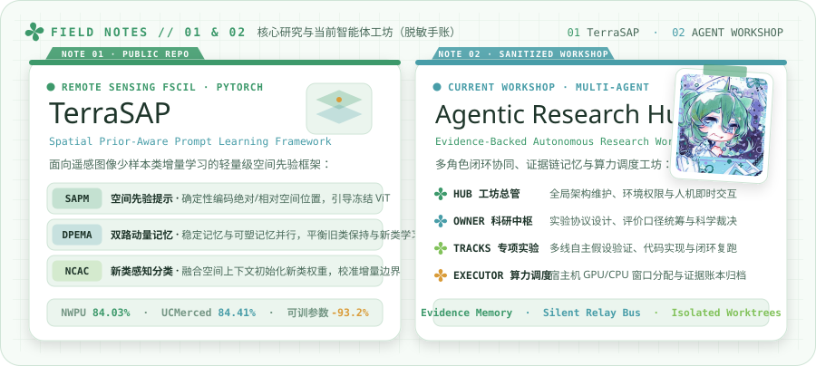
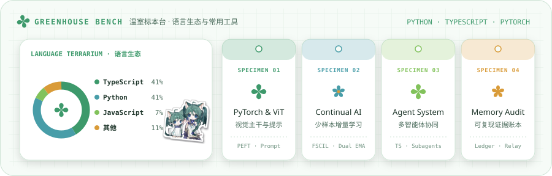
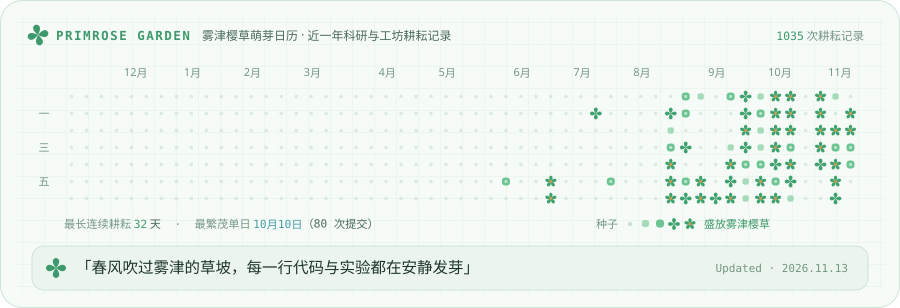

<!-- cards/ 由 gen.ts 生成：npm run update 拉最新数据并重新生成，然后提交推送 -->

  <picture>
    <source media="(prefers-color-scheme: dark)" srcset="cards/header-dark.svg">
    
  </picture>

  <a href="https://github.com/Zakura-sa/TerraSAP">
    <picture>
      <source media="(prefers-color-scheme: dark)" srcset="cards/link-terrasap-dark.svg">
      
    </picture>
  </a>

  <picture>
    <source media="(prefers-color-scheme: dark)" srcset="cards/works-dark.svg">
    
  </picture>

  <picture>
    <source media="(prefers-color-scheme: dark)" srcset="cards/toolkit-dark.svg">
    
  </picture>

  <picture>
    <source media="(prefers-color-scheme: dark)" srcset="cards/garden-dark.svg">
    
  </picture>

